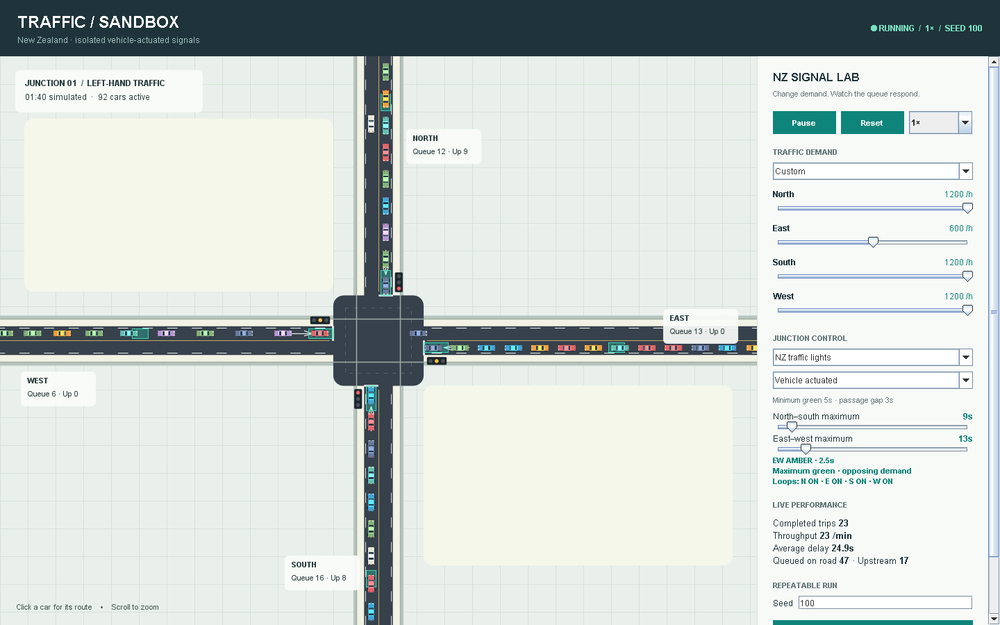
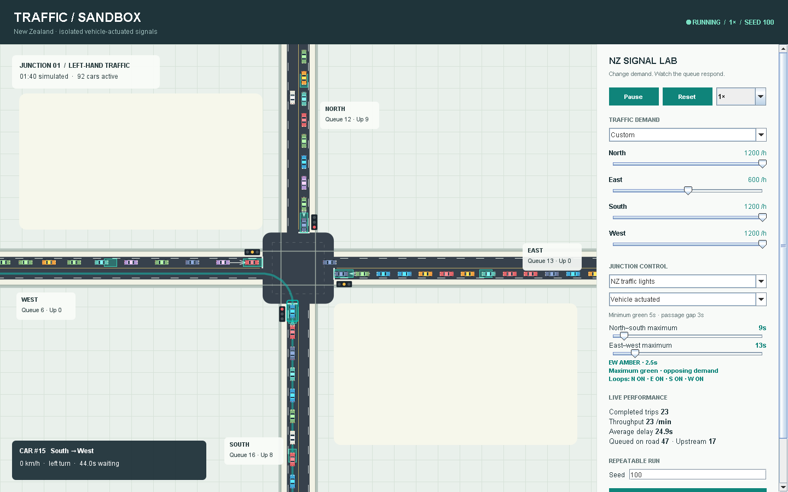

# Traffic Sandbox

A New Zealand traffic-signal lab, starting with an isolated vehicle-actuated urban
intersection. Cars trigger limit-line and advance detectors; the controller
remembers calls, extends green, and changes safely when competing traffic needs
service. Cars follow left-hand lanes, turn, and leave the network.

The Java platform separates geometry, signal control, simulation, scheduling and
desktop presentation. Built with Swing and Java2D, with no external runtime
dependencies. See the [architecture](docs/architecture.md) and
[NZ model evidence and assumptions](docs/nz-signal-model.md).



## Run

Install a JDK with `java`, `javac` and `jar` on PATH. Java 11 or newer is supported;
development was validated with JDK 14, and CI uses JDK 17. In PowerShell:

```powershell
cd C:\src\traffic-sandbox
./run.ps1
```

To build the standalone JAR or run the tests:

```powershell
./build.ps1
java -jar build/traffic-sandbox.jar
./test.ps1
```

The GitHub Actions **traffic-sandbox** artifact contains the runnable JAR. It can
be run on any desktop platform with Java 11+. The provided build scripts target
PowerShell, including PowerShell 7 on non-Windows systems.

## Try an experiment

1. Start with **Balanced** traffic and observe all four approach queues.
2. Select **Main-road rush** and increase north–south's maximum green.
3. Switch to **Give way** to make north–south the priority road.
4. Try **Heavy traffic** to see approach queues and upstream backlog grow.
5. Compare **Vehicle actuated** with **Fixed-time comparison**, including a road
   with zero arrivals. Actuated signals avoid serving an empty opposing road.
6. Reset with the same seed to compare configurations using the same generated
   arrivals. **Repeat run** restores the seed, rates, mode, control strategy and maximum green settings captured
   at the start of the current run. Mid-run control changes are not automatically
   replayed.

Changes to arrival rates apply immediately. Signal timing changes take effect at
the next green phase. A mode change suspends new junction admissions, includes
yellow when leaving a green signal, then waits through all-red and junction
clearance. Switching back to traffic lights also includes all-red clearance.

## Controls

| Control | Behavior |
| --- | --- |
| Four arrival sliders | 0–1,200 vehicles/hour per approach |
| Maximum-green sliders | 5–60 seconds per axis; actuated maximum starts with an opposing call |
| Signal strategy | Vehicle-actuated control or fixed-time comparison |
| Detector outlines | Turquoise when a vehicle occupies a limit-line or advance loop |
| Controller explanation | Current phase, safety countdown and reason for its decision |
| Pause / Space | Pause or resume simulation time |
| Reset / R | Clear traffic and metrics; start the current settings with the entered seed |
| Repeat run | Restore the starting settings and seed |
| 1× / 2× / 5× | Change playback speed without changing the model step |
| Hold Right Arrow | Temporarily run at 5× |
| Click a car | Highlight its route, speed, destination and waiting time |
| Mouse wheel | Zoom the map |

Seed values are signed whole numbers. While editing the seed, keyboard shortcuts
do not interfere with typing. Entering an invalid seed shows an inline message
and leaves the simulation running.

A selected car highlights its complete route through the junction:



## What the numbers mean

- **Queue:** cars on an incoming lane moving below 0.5 m/s.
- **Upstream:** generated arrivals waiting for space at the road entrance; they
  have not yet spawned on the visible network. Demand is never silently dropped.
- **Completed trips:** cars that reached their destination and fully left the network.
- **Throughput:** completed trips in the previous 60 seconds of simulated time.
  Displayed as `—` until one full minute has elapsed.
- **Average delay:** mean completed-trip duration, including upstream waiting,
  minus that route's unobstructed travel time at the configured straight and
  cornering speeds. The reference assumes immediate attainment of those speeds,
  so acceleration contributes to the measured delay. Displayed as `—` until a trip
  completes.
- **Car waiting time:** upstream time plus on-road time spent below 0.5 m/s.

## Model and architecture

- Fixed four-way junction, one incoming and one outgoing lane per arm, left-hand
  driving, and all twelve straight/left/right routes. No U-turns or lane changes.
- Seeded independent exponential arrivals. Destination split: 60% straight,
  20% left and 20% right. Default rates are 300 vehicles/hour on each approach.
- Distances use metres; speeds use metres/second. Cars are 4.5 × 1.8 m, with a
  50 km/h speed limit, lower cornering speeds, a 1.5-second desired headway and
  a 2 m minimum following gap. IDM-style acceleration is bounded by +2 and
  −4.5 m/s²; a final numerical gap safeguard prevents overlap.
- A conservative swept-path conflict matrix and reservations protect junction
  movements. Compatible paths can operate concurrently. Receiving-lane space
  is checked before admission. Reservations can be made on the final 18 m of
  an approach and persist until the rear clears the junction.
- NZ isolated actuation is the default: remembered calls, 5 s minimum green,
  3 s passage gap and adjustable competing-demand maximum. Green rests when
  no opposing demand exists. Physical vehicle bodies activate loops; upstream
  queues do not act as invisible detectors.
- Two opposing-axis phases use three seconds of yellow and at least two seconds
  of all-red, extended until reservations clear. Existing reservations finish
  safely; new reservations are disabled during yellow. Right turns filter through
  conflicting traffic. These are declared scenario timings, not universal NZ values.
- Give-way control prioritizes north–south, checks approaching major-road traffic,
  and resolves equal priority by approach arrival order and then vehicle ID.
- The model advances at 50 Hz on one dedicated thread. Swing controls enqueue
  commands; the UI reads immutable snapshots and interpolates car positions.
  Rendering is procedural and cached. Running the app writes no car textures.
- Active traffic is capped at 240 cars; incoming lane space usually limits it
  sooner. Upstream demand queues may grow under sustained overload.

This is a simplified traffic experiment, not a calibrated prediction of a real
intersection. Whole-movement reservations are deliberately conservative and can
reduce throughput, especially when turning traffic blocks a shared incoming lane.
High demand can cause persistent queues or minor-road starvation under give-way
control. There are no pedestrians, protected turn-arrow phases, driver aggression,
SCATS network coordination or road construction in this version. Local vehicle
actuation is implemented; SCATS optimisation is a separate future capability.

The model is separated into road geometry, vehicle/demand state, intersection
control and metrics. The UI and runner consume these through fixed steps,
commands and snapshots, leaving room for more road layouts later.

## Validation

`test.ps1` checks package dependency boundaries, isolated detector/controller
behaviour, route completion, repeatability, playback grouping, following,
blocked receiving lanes, signal phases, mode changes, priority, metrics, reset,
snapshots and recovery. A seeded 30-minute stress scenario alternates control
modes and introduces a temporary blocked exit. Interface tests exercise the real
Swing controls and render the complete UI at 1000 × 700, 1440 × 900 and
1920 × 1080. Tests also check geometric vehicle overlap and conflicting reservations.

For an optional live-window acceptance check after `test.ps1`:

```powershell
java -ea -cp 'build/classes;build/test-classes' traffic.desktop.DesktopTest
```

See [validation results](docs/validation.md) for measured local performance and
the distinction between offscreen paint speed and live desktop rendering.

## Origin

Developed from Keeghan Campbell's TrafficSimulator project. The original
`traffic-simulator` checkout and private Git history are preserved separately;
this public repository starts with new history and excludes the original project
form. See [source attribution](NOTICE.md).
